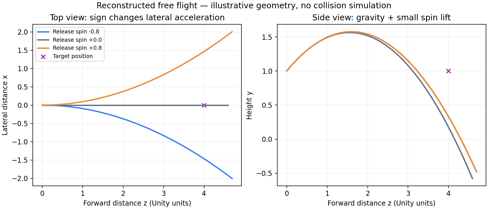

# Pokémon GO throwing physics: static reconstruction

Recovered from Android **0.435.2**, build **2026110702**, ARM64, on 2026-11-15.
This project reconstructs the ordinary Poké Ball **gesture math, launch velocity,
speed assistance and free-flight curve acceleration**. It is executable source,
not a speculative projectile formula. It is also **not a complete encounter
replica or a gameplay-validated, bit-identical implementation**.

## Run

From the repository root, run `cd docs/pokeball-throw` first.
Python 3.10 or newer, no dependencies for the model (checked with Python 3.12):

```sh
python3 physics.py --swipe 1.2 3.0 --spin -0.8 > trajectory.csv
python3 -m unittest -v test_physics.py
```

`--swipe` is screen-widths/second and screen-heights/second, with positive y up.
`--spin` is the release angular velocity along the ball's local z axis divided
by its maximum angular velocity. It is **not** the gesture's torque impulse.
The default ball `(0,1,0)` and target `(0,1,4)` are illustrative scene inputs.
The CLI emits launch diagnostics to stderr and trajectory samples to stdout.

`physics.py` also exposes `swipe_velocity`, `spin_points`, `spin_impulse`,
`target_speed`, `launch`, `curve_acceleration` and `trajectory`.

`ReconstructedThrow.cs` ports the core equations to Unity 6 and uses Rigidbody
for integration, inertia and spin. Attach it to a ball with a Rigidbody and a
SphereCollider; the extracted ordinary prefab radius is about **0.06** Unity
units. Call `ApplySpin` with gesture triples, and `Release` with normalized
swipe velocity, the actual release/target geometry and camera rotation. It
exposes the recovered defaults for overrides. This C# source has **not been
compiled or play-tested inside Unity**. Touch UI, held-ball positioning and
encounter state transitions are intentionally caller responsibilities.

Optional plot: `python3 demo_plot.py` (requires matplotlib).



## Recovered pipeline

### 1. Gesture velocity and release gate

`EncounterGestureHandler.buvf`, RVA `0xad6fe48`, walks backwards through timestamped
touch positions. It averages each segment's velocity after dividing x/y by
screen width/height. Segments receive **equal weight**, even if their durations
differ. The packaged lookback is **0.13 seconds**. The first segment beginning
before the window is included, then iteration stops.

Release requires positive vertical velocity and a direction within a **140°**
cone around screen-up: `vy / length(v) > cos(70°)`. These checks appear in
`buvd` (`0xad6ecac`) and `buvh` (`0xad700cc`). The Python wrapper rejects
invalid/nonincreasing timestamps rather than propagating the game's possible
division-by-zero results for malformed input.

### 2. Gesture spin

`FrameBasedSpinGestureHandler.OnTouchMoved` (`0xad70710`) selects the last three
positions. `TimeBasedSpinGestureHandler.OnTouchMoved` (`0xad70b20`) instead
selects a historical triple spanning a configurable window, **0.07 seconds**
by default; its middle point is chosen near the half-window boundary.
Which handler is active depends on runtime configuration and has not been
observed on a device. Both are exposed in the Python model.

With screen-normalized points A, B, C:

```text
gestureScalar = spinMultiplier * cross2D(B - A, C - A)
```

The packaged multiplier is **3**. `Pokeball.Spin` (`0xacd4464`) calls:

```text
Rigidbody.AddRelativeTorque((0, 0, -gestureScalar), ForceMode.Impulse)
```

PhysX inertia, angular damping, fixed-step timing and repeated gesture calls
determine the resulting angular velocity. The model does not invent a scalar
conversion from torque impulse to release spin. The Unity port delegates this
to Rigidbody, as the original does.

### 3. Launch vector and assistance

`Pokeball.Launch`, RVA **`0xacd3bf8`**:

```text
x = sign(vx) * multiplier.x * ln(1 + abs(vx))
f = multiplier.y * ln(1 + vy)
theta = LerpAngle(minAngle, maxAngle,
                 Clamp01(pokemonHeightOffGround / maxAngleHeight))
raw = (x, f*sin(theta), f*cos(theta))
speed = min(length(raw), maxLaunchSpeed)
```

The height input is `IEncounterPokemon.HeightOffGround`; it is not the target's
height relative to the ball. Launch is rejected if capped speed is at or below
the speed threshold.

`Pokeball.btri` (`0xacd7b4c`) computes a target-dependent reference speed:

```text
d = length(targetPosition - ballPosition)       # full 3D distance
h = targetPosition.y - ballPosition.y
ideal = sqrt(abs(d*d*gravityY / (2*(d*tan(theta) - h)))) / cos(theta)
```

The **3D distance** and **absolute value** are observable implementation choices;
substituting the usual horizontal-range projectile formula changes behavior.
The helper is named `target_speed` here rather than assuming its internal name.

For the non-AR branch (`CurrentArMode == 0`):

```text
k = overshootCorrection if speed > ideal else undershootCorrection
speed = Lerp(speed, ideal, Clamp01(k))
velocity = cameraYawRotation * normalize(raw) * speed
```

The speed cap precedes correction, so the final speed can exceed that cap.
The nonzero AR branch skips this correction and uses the camera's full rotation.
Master Ball has a separate path and is outside this reconstruction.

### 4. Curve acceleration

`Pokeball.btqw` (`0xacd0f20`) computes:

```text
s = ballTransform.InverseTransformDirection(body.angularVelocity).z
    / body.maxAngularVelocity
```

The flight coroutine `Pokeball.ebg.MoveNext` (**`0xace2bc4`**) samples this at
flight entry. If `abs(s) > MinSpinParticleAmount`:

```text
localAcceleration = (curve.x*s, curve.y*abs(s), curve.z*abs(s))
worldAcceleration = encounterCameraRotation * localAcceleration
```

Otherwise the curve vector stays zero. The coroutine **stores** that vector,
then applies it with `Rigidbody.AddForce(..., ForceMode.Acceleration)` while
yielding `Schedule.NextFixedUpdate`. It does not recompute a Magnus force from
the ball's current velocity, nor reduce the stored force as visible spin damps.
Ordinary flight enables Rigidbody gravity. Thus pre-collision motion is driven
by gravity plus this constant acceleration, subject to Unity integration.

## Extracted ordinary-prefab defaults

Source: `sharedassets1.assets`, GameObject **4090** (`Pokeball`), MonoBehaviour
**111909**, MonoScript **2806**. The two other `Pokeball` components belong to
`PokeballMine`/`PokeballTheirs`; their zero-valued properties were not substituted
for the ordinary encounter prefab.

| Setting | Packaged value |
|---|---:|
| Gravity y | −9.8100004196167 |
| Velocity multiplier x / y | 1 / 4 |
| Min / max launch angle | 36° / 45° |
| Height for maximum angle | 1.5 |
| Maximum speed before assistance | 15 |
| Launch-speed threshold | 0.2 |
| Overshoot / undershoot correction | 0.8 / 0.15 |
| Curve modifier x / y / z | 5 / 0.25 / 0.25 |
| Spin threshold | 0.4 |
| Maximum angular velocity | 50 |
| Drag snap speed | 16 |
| Rigidbody mass / linear damping / angular damping | 1 / 0 / 1 |
| Collider radius | 0.06 |
| Flight timeout / below-ground timeout | 3 s / 1 s |

The packaged fixed timestep is the rational `2822399 / 141120000`, approximately
0.02 seconds. Runtime code may change it. The Python integrator takes an explicit
step size and uses double precision, whereas Unity uses float/PhysX behavior.

Several property getters can select configuration overrides. These values are
**artifact defaults, not a claim about the live service's effective settings**.
See `evidence/assets/throw-properties.json`, `objects.json`,
`physics-settings.json` and `time-manager.json` for the extracted facts.

## Validation and remaining boundaries

- **7 tests pass**: segment averaging/window boundary, screen normalization,
  release gate, speed assistance/cap ordering, curve sign/threshold, time-based
  spin-point selection, and constant-acceleration integration convergence.
- **12 native arithmetic comparisons pass**: Unicorn emulates the actual ARM64
  instructions at `0xacd7bf4..0xacd7c78`, with supplied positions/angle and mocked
  Unity gravity/libm calls. Maximum absolute difference from `target_speed` is
  approximately **2.65e-6** across the checked cases. Includes raised and lowered
  targets and the denominator-sign case. Results are in
  `evidence/native-math-validation.json`.
- This does **not** validate the complete gesture-to-flight sequence against
  a running Pokémon GO client. Live settings, active spin handler, actual
  release/target positions, camera pose, event ordering and collision geometry
  remain inputs to capture for a perceptually exact match.
- Held-ball screen-to-world positioning and smoothing are not implemented.
  The relevant helper `btrc` was located, but its decompilation timed out. The
  model explicitly accepts the release world position rather than guessing it.
- Catch grading/outcomes, bounces, Pokémon animations, special balls, AR scene
  tracking, ground/miss state transitions and timeouts are not simulated. The
  example trajectories deliberately continue without collision resolution.

## Tooling and provenance

APKPure supplied the base APK and ARM64 split; exact URLs, sizes and SHA-256
hashes are in `evidence/provenance.json`. The base/split declare the same
certificate fingerprint:
`944bda466eaf64be1c93896d5c8e9a454a07c8d8fcbc4adeeefb3545b335e979`.
REA found matching content digests. Its signature-inspection tool does not
cryptographically authenticate signer signatures; no stronger authenticity
claim is made here.

REA **6.9.0** successfully decoded IL2CPP metadata version **39**. Its automatic
native-link step first exceeded its 1 GiB estimated relocation-index allowance.
A local modification raised that allowance to 4 GiB; the next attempt still
refused an unresolved-pointer ambiguity. That output is **not** treated as a
successful native mapping. Il2CppDumper 6.7.46 also failed (unsupported v39).

`tools/map_methods.py` instead links MethodDef tokens through ELF relative
relocations and unique code-generation module records, checking pointer counts
and executable ranges. It mapped 264,865 bodies across 215 nonempty modules.
`tools/read_types.py` identifies metadata registration and recovers field types,
field offsets and method signatures. Ghidra **12.2** performs targeted static
decompilation; direct ARM64 assembly is used to check ambiguous pseudocode.
UnityPy **1.25.4** reads packaged Unity assets. `tools/DumpThrows.java` records
Ghidra's 0x100000 image-base shift; RVAs in this report exclude that shift.

This directory contains the independently written reconstruction, tests,
research helpers and compact factual evidence. APKs, native libraries, metadata
dumps, decompiler installations and the complete decompiled output are not
included. See [REPRODUCING.md](REPRODUCING.md) for optional analysis dependencies,
required inputs and the order in which to run the helpers.

## Relationship to Roguewood

This is a standalone research reference for the gesture inspiration described in
[the game plan, section 5](../../Roguewood-Game-Plan.md#5-throwing-pokémon-go-gesture-bowling-outcome).
It does not change Roguewood's Godot throwing implementation, bowling rules or
existing physics decisions. `.gdignore` keeps the Unity example and research
artifacts out of Godot's resource import. The plotted trajectories are generated
scientific illustrations, not screenshots or captures of either game.
